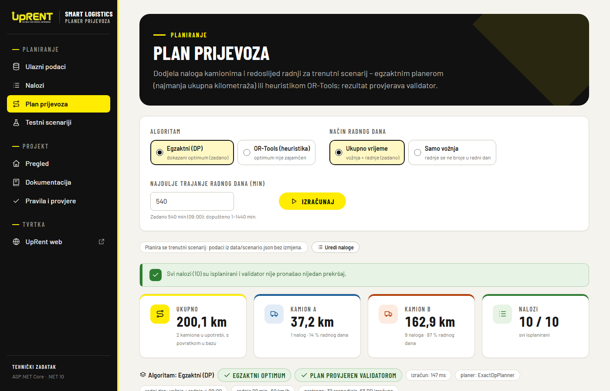
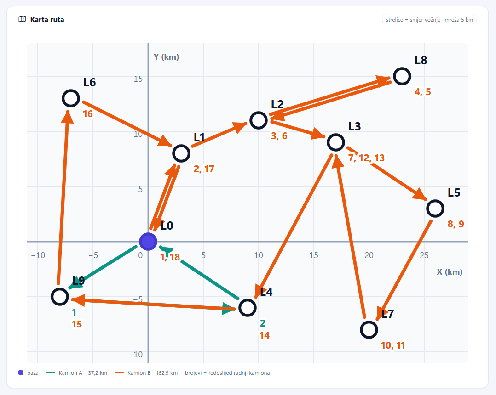

# Smart Logistics Planner

A web application that plans the transport of construction machines with two trucks – assigning orders to
trucks, ordering pickups and deliveries, and minimising the total distance with a mandatory return to the depot.

---

## 1. Prerequisites and running

**Prerequisites:** .NET 10 SDK (the solution also builds with SDK 11). No database and no external services.

```bash
cd SmartLogistics
dotnet build
dotnet test
dotnet run --project src/SmartLogistics.Web
```

Open the URL printed by `dotnet run` (launch profile: `http://localhost:5186`). In Visual Studio or VS Code open
`SmartLogistics/SmartLogistics.slnx` and start `SmartLogistics.Web`.

The input data is in [`data/scenario.json`](SmartLogistics/data/scenario.json). It is loaded into an in-memory store when the
application starts; orders can then be added, edited and deleted on the **Nalozi** page and reset to the original
file with **"Vrati izvorne podatke"**. The user interface is in Croatian; code, comments and this README are in English.

| Page | URL | Content |
|------|-----|---------|
| Ulazni podaci (input data) | `/` | Trucks, machines, locations and orders; map of orders; 10 × 10 distance matrix |
| Nalozi (orders) | `/Orders` | Add, edit and delete orders, including a new machine with a typed-in weight |
| Plan prijevoza (transport plan) | `/Plan` | Plan per truck, warnings, validator result, SVG route map; query parameters `algoritam=exact|ortools`, `nacin=ukupno|voznja`, `maxMinuta=1..1440` (e.g. `/Plan?algoritam=ortools&nacin=voznja&maxMinuta=300`) |
| Pregled, Dokumentacija, Pravila i provjere | `/Pregled`, `/Dokumentacija`, `/Pravila` | Project progress, project documents, rules and validator coverage |

## 2. Screenshots





## 3. The problem

This is a **Pickup and Delivery Vehicle Routing Problem (PDP-VRP)** with capacities and a working-day limit:

- Two trucks start and end at the depot L0: **A** – 3500 kg, at most 2 machines; **B** – 10000 kg, at most 3 machines.
- Ten orders; each order moves one machine (800–9400 kg) from a pickup location to a delivery location.
- The same truck picks up and delivers an order, and the pickup comes before the delivery.
- Weight and machine count must stay within the truck's limits **after every action**.
- A leg is the Euclidean distance between two locations, **rounded to one decimal** before legs are summed.
- Speed is 60 km/h (1 km = 1 min); every pickup or delivery takes 20 min, also at the depot.
- The driver may drive 9 hours a day.
- Goal: minimise the total distance; orders that cannot be served must be reported clearly.

The task was turned into 40 numbered, testable rules in [docs/spec.md](SmartLogistics/docs/spec.md).

## 4. Assumptions

All assumptions and decisions are recorded with their reasons in [docs/odluke.md](SmartLogistics/docs/odluke.md). The most important:

- **"9 hours of driving" is ambiguous.** The default `WorkdayMode.Total` counts driving **and** actions
  (≤ 540 min per truck, including the return to the depot). The alternative `WorkdayMode.DrivingOnly` counts driving
  only. The application shows both. The interpretation changes the result:

  | Mode | Total distance | Why |
  |------|---------------:|-----|
  | `Total` (default) | **200.1 km** | Truck B cannot do all 10 orders within 540 min (400 min of actions + at least 182.2 min of driving), so truck A takes one order. |
  | `DrivingOnly` | **182.2 km** | Truck B does all 10 orders; its working day including actions is 9 h 42 min. |

- A feasible order is never dropped to save kilometres: the objective is **most planned orders, then fewest km**.
- One working day, one continuous route per truck; the depot appears in the middle of a route only as the place of an
  action (orders N04 and N05). Empty intermediate stops are not allowed.
- Invalid input never stops planning – the planner always returns a plan (see *Infeasible orders* below).

## 5. Optimisation logic

The exact planner is `Core/Planning/ExactDpPlanner.cs`; a detailed walkthrough is in [docs/planer.md](SmartLogistics/docs/planer.md).

**Assignment.** An order may go only to a truck that can carry its machine. Orders N06–N10 (3900–9400 kg) fit only
truck B; for the five orders both trucks can carry (N01–N05) **all 2^5 = 32 assignments** are tried.

**Dynamic programming per truck.** For every truck and its set of orders the shortest route is computed exactly.
The state is **(current location, status of every order)**, where the status of an order is 0 = not picked up,
1 = on the truck, 2 = delivered, encoded as one base-3 number. The value of a state is the minimum remaining distance
to finish all orders and return to the depot, memoised in a dictionary. A pickup is allowed only if the weight and
machine count after it fit the truck; the load is derived from the status, not stored. The route is reconstructed
from the memo. Distances are kept in whole tenths of a kilometre (`int`), so sums and ties are exact and the result
is deterministic.

**Why the result is optimal.** The DP explores every valid sequence of actions for a truck (the remaining distance
depends only on the state, so memoisation is correct); once the assignment is fixed the trucks are independent; and
all assignments are enumerated. The minimum found is therefore the global minimum. It is confirmed independently:
the plan passes a validator written only from the specification, and an exhaustive test oracle reproduces the same totals.

**Why the working day is checked afterwards.** For a fixed set of m orders every route has exactly 2m actions, so the
action time is constant, while driving time grows with distance. The shortest route is therefore also the fastest:
if it does not fit the working day, no route for that set does. Time is checked once, after the DP.

**Complexity.** Up to ∏ (trucks per order) assignments; one DP over m orders has at most 3^m × (2m + 1) states, each
with O(m) work; with caching per (truck, order set) the worst case is O(T · 4^n · n²). For the task data the search
evaluates 32 assignments, solves 63 DPs with 284,366 states and takes about 0.1–0.15 s in the running application (152 ms for `Total`, 114 ms for `DrivingOnly` on first request).

**Scaling.** Measured on synthetic data where every order fits both trucks, each extra order roughly multiplies the
time by four: 10 orders 0.7 s, 12 orders 11 s, 14 orders 175 s (see [docs/planer.md](SmartLogistics/docs/planer.md)). For larger
problems the application also offers a heuristic planner, `Core/Planning/OrToolsPlanner.cs` (Google OR-Tools:
pickup-and-delivery pairs, weight, count and time dimensions, `PATH_CHEAPEST_ARC` + `GUIDED_LOCAL_SEARCH`, 5 s limit).
Its result goes through the same validator, and the UI marks it as "optimum not guaranteed". See *Results* for the
comparison on the task data.

**Infeasible orders.** Before planning, `Core/Feasibility.cs` classifies every order: **K4** invalid data (unknown
machine or location, pickup = delivery, weight ≤ 0, duplicate order), **K1** machine heavier than every truck,
**K2** the order alone does not fit into the working day. If the remaining orders cannot all fit into the working day,
the planner leaves out the smallest possible number of orders (one, then two, …) and, among those plans, picks the one
with the fewest kilometres; omitted orders are **K3** ("Ne stane u radni dan"). Every infeasible order is shown with
its reason and numbers.

## 6. Architecture

```
src/SmartLogistics.Core      domain logic, no dependency on Web
  Domain/                    records: Location, Truck, Machine, TransportOrder, Scenario, Stop, TruckRoute, Plan, PlanningOptions
  Distance.cs                rounded legs and distance matrix
  Feasibility.cs             input checks and infeasible orders (K1, K2, K4)
  Planning/                  IRoutePlanner, ExactDpPlanner (exact), OrToolsPlanner (heuristic)
  Validation/                PlanValidator – independent plan validator
src/SmartLogistics.Web       ASP.NET Core Razor Pages
  Pages/                     Index (input data), Orders (CRUD), Plan, Pregled, Dokumentacija, Pravila
  Pages/Shared/              partial views (tables, plan summary, warnings, route table, SVG map, forms)
  ViewModels/                everything a page shows, already formatted (km, kg, hh:mm, % of capacity)
  Services/                  in-memory scenario store, plan service with cache, document reader
  wwwroot/css/site.css       the whole design system (CSS variables, sl- prefixed classes, no inline styles)
tests/SmartLogistics.Tests   xUnit tests
data/scenario.json           input data from the task
docs/                        task, specification, decisions, planner walkthrough, results, AI log, time
```

- **Core** has no dependency on Web. Planners implement `IRoutePlanner`; both are registered in the web application
  and selected on the plan page.
- **Web** uses Razor Pages. Pages never render domain objects directly; they get view models from mappers, which do
  all formatting. Repeated parts are partial views. The SVG map is generated on the server (the y axis is flipped in
  the view model, because the SVG y axis points down).
- **In-memory store** (`IScenarioStore`): deliberately simple for a single-user demo (state is lost on restart); a real
  system would use a database.
- **Independent validator.** `PlanValidator` was written from the specification only, without reading the planner
  code. It replays every route from the depot, recomputes all kilometres, minutes and loads, and returns **all**
  violations with the rule ID, truck and step. Every planner must pass its result through the validator before
  returning it; a violation is treated as a bug.

## 7. Results

Measured by running the application (`/Plan`) on `data/scenario.json`, working day 540 min. All plans pass the
validator with 0 violations and no order is infeasible.

| Mode | Truck | Orders | Distance | Driving | Actions | Total time | Working day used |
|------|-------|-------:|---------:|--------:|--------:|-----------:|-----------------:|
| `Total` | A | 1 (N03) | 37.2 km | 00:37 | 00:40 | 01:17 | 14 % |
| `Total` | B | 9 | 162.9 km | 02:43 | 06:00 | 08:43 | 97 % |
| `Total` | **both** | **10 / 10** | **200.1 km** | | | | |
| `DrivingOnly` | A | 0 | 0.0 km | – | – | – | unused |
| `DrivingOnly` | B | 10 | 182.2 km | 03:02 | 06:40 | 09:42 | 34 % (driving only) |
| `DrivingOnly` | **both** | **10 / 10** | **182.2 km** | | | | |

**Exact planner vs OR-Tools** (same application, same data):

| Case | Exact DP | OR-Tools | Computation time (exact / OR-Tools) |
|------|---------:|---------:|------------------------------------:|
| `Total`, 540 min | 200.1 km, 10 / 10 | 200.1 km, 10 / 10 (same split A 37.2 / B 162.9) | 152 ms / 2.7 s |
| `DrivingOnly`, 540 min | 182.2 km, 10 / 10 | 182.2 km, 10 / 10 | 114 ms / 2.3 s |
| `Total`, 300 min | 203.8 km, 8 / 10 (N08, N09 left out) | 212.0 km, 8 / 10 | – |

OR-Tools reaches the optimum on the task data, but not in general: with a 300-minute day it leaves out as many
orders as the exact planner but drives 8.2 km more. A single default guided-local-search run with the 5 s limit
found only 9 of 10 orders (156.4 km) in `Total` mode; the planner therefore runs two guided-local-search
configurations with a solution limit (deterministic) and keeps the better plan (see [docs/odluke.md](SmartLogistics/docs/odluke.md), T55).

Full routes (location, action, order, load after every action): [docs/rezultati.md](SmartLogistics/docs/rezultati.md).

## 8. Tests

`dotnet test` – **323 tests, all green** (about 25 s; the OR-Tools tests run on their own, without parallelism, because
each OR-Tools call takes 2–3 s).

| Test class | Tests | What it proves |
|------------|------:|----------------|
| `DistanceTests` | 16 | Legs are Euclidean and rounded to one decimal before summing (L0→L1 = 8.5, L3→L8 = 8.5, L5→L9 = 34.9), symmetric, zero to itself; midpoint rounding away from zero |
| `ScenarioDataTests` | 7 | `data/scenario.json` matches the task; default options 540 min / 20 min / 60 km/h |
| `PlanBuilderTests` | 4 | The helper that builds plans by hand for validator tests computes the same numbers as a manual calculation |
| `PlanValidatorValidPlanTests` | 15 | Valid plans and boundary cases pass: exactly 10,000 kg, exactly 2 machines, working day exactly at the limit, actions at the depot, unused truck |
| `PlanValidatorViolationTests` | 38 | Hand-built invalid plans are rejected with the right rule: overload (R11), too many machines (R12), delivery before pickup (R6), picked up by A and delivered by B (R5), no return to the depot (R2), machine left on the truck (R28), wrong km (R16), working day exceeded (R20/R21), order on two trucks, missing order, and more |
| `ReferenceSolutionTests` | 9 | The planner returns 200.1 km (`Total`) and 182.2 km (`DrivingOnly`), its plans pass the validator, one route per truck, deterministic, `DrivingOnly` ≤ `Total` |
| `ReferenceOracleTests` | 83 | A second, deliberately simple exact implementation (Dijkstra over states, no shared code) gives the same total km and number of planned orders as the planner on the task data and on 20 seeded random scenarios in both modes |
| `InvalidInputPlanningTests` | 36 | Invalid input never crashes the planner: 11,000 kg machine (K1, rest at 200.1 km), unknown location, pickup = delivery, weight ≤ 0, duplicate order, unknown or reused machine, missing depot, unusable trucks |
| `WorkdayOverflowPlanningTests` | 19 | Working day too short (300 / 200 / 80 min): the plan passes the validator, omitted orders are K3 "Ne stane u radni dan", the number of omitted orders is minimal and the km are confirmed by an independent exhaustive oracle |
| `OrToolsPlannerTests` | 17 | The OR-Tools plan passes the validator, is never better than the exact plan (more orders, or fewer km for the same number of orders), is deterministic, and is marked as not guaranteeing the optimum |
| `WebMapping.FormatTests` | 44 | Formatting in view models: km with one decimal ("162,9 km"), kg with a thousands dot ("10.000 kg"), hh:mm with rounding to whole minutes ("08:43"), percentages of capacity and of the working day |
| `WebMapping.PlanMapperTests` | 22 | The plan mapper: departure and return rows, load and % of capacity after every action, working-day percentage per mode (B in `Total` = 97 %), unused truck |
| `WebMapping.MapViewModelTests` | 13 | The SVG map: y = −Y (L4, south of the depot, is drawn below it), view box with margin, invariant-culture numbers, route segments and legend |

## 9. AI tools

The project was built with **Claude Code** (model Claude Opus 5.5) in VS Code. A human technical lead set the phases,
decided every assumption and reviewed every phase; the AI wrote the code, tests and documents.

**How the work was organised**
- Project rules in `CLAUDE.md` (domain, reference values, UI rules, way of working) and six sub-agents with narrow
  scopes in `.claude/agents/`: domain analyst, validator engineer, test engineer, solver engineer, UI builder, reviewer.
- Specification first (rules R1–R40 in `docs/spec.md`), code second. Ambiguities such as "9 h: driving only or driving
  plus actions?" were decided by the human and turned into rules.
- **Independent checks instead of trust:** the validator was written without access to the planner and recomputes
  all km and minutes; the reference values (200.1 / 182.2 km) were computed independently before the planner existed;
  a second exact implementation (Dijkstra oracle) and the OR-Tools planner cross-check the exact planner.
- After each phase the AI stops with a report and a proposed commit message; every deviation from the task is
  recorded in `docs/odluke.md` (T1–T65) with its reason and alternative.

**What worked well**
- Two independent implementations caught each other's mistakes: the validator rejected a wrong "valid" test plan
  (R32), and the solver engineer measured that the prescribed OR-Tools setting (one GLS run, 5 s) leaves an order
  unplanned and reported it instead of accepting it (T55).
- Sub-agents reported problems outside their scope instead of "fixing" them.
- Screenshots of the running app and the read-only reviewer found problems that build and tests do not see.

**What needed attention**
- The AI tends to widen the task silently (extra fields, methods, checks); the rule "every deviation goes into the
  decision log" was added after this was noticed.
- Things outside the project folder (the git root one level up, a nested git repository, how GitHub shows the
  repository) were not treated as part of the task and were caught by the human or the reviewer.
- Restrictions given only in a prompt (e.g. "the validator agent must not read `Core/Planning/`") cannot be enforced
  technically.

All AI mistakes, who caught them and how they were fixed: [docs/ai-log.md](SmartLogistics/docs/ai-log.md) (Croatian).

## 10. Time spent

| Session | Date | Effective | Phases |
|---------|------|---------:|--------|
| Development | 20.–21.11.2026 | ~1 h 20 min | 0–10: specification, domain, validator and tests, exact planner, infeasible orders, web UI, OR-Tools, reference oracle, review, README |
| Submission preparation | 21.11.2026 | ~40 min | README in the repository root, screenshots, GitHub branches, these sections, updated time and AI log |
| **Total with Claude Code** | | **~2 h** | |

Durations are the author's estimate of effective work: about a third of the time elapsed between git commits, file
timestamps and session log entries; the rest was waiting for sub-agents and breaks. From phase 6 on several
sub-agents worked in parallel. Time outside the sessions (reading the code, preparing the presentation, Azure
deployment) is added by the author. Per-phase breakdown:
[docs/vrijeme.md](SmartLogistics/docs/vrijeme.md) (Croatian).

## 11. Known limitations and next steps

- **Straight-line distances.** Legs are Euclidean; real road distances and travel times (e.g. from a routing service)
  would replace `Distance.Leg` and the distance matrix.
- **No time windows.** Opening hours or fixed pickup and delivery times are not modelled; they would become an extra
  time dimension in both planners and new validator rules.
- **One working day.** Orders that do not fit are reported as infeasible instead of being moved to the next day; a
  multi-day plan needs a day index in the model.
- **Two trucks, exact search.** The exact planner grows roughly as 4^n with the number of orders both trucks can
  carry; with more vehicles or orders the OR-Tools planner (or another solver) must take over, with "optimum not
  guaranteed".
- **In-memory store.** Edits are lost on restart and there is one shared state for all users; production would use a
  database with users, concurrency control and history.
- **Editing in the UI** covers orders (and new machines) only; trucks and locations are edited in `data/scenario.json`.

## Documents

| Document | Content |
|----------|---------|
| [docs/zadatak.md](SmartLogistics/docs/zadatak.md) | Original task (Croatian) |
| [docs/spec.md](SmartLogistics/docs/spec.md) | Rules R1–R40, ambiguities, derived facts, edge cases |
| [docs/odluke.md](SmartLogistics/docs/odluke.md) | Decision log with status; decisions waiting for approval at the top |
| [docs/planer.md](SmartLogistics/docs/planer.md) | Exact planner walkthrough: flow, DP state, optimality, complexity, measured scaling |
| [docs/rezultati.md](SmartLogistics/docs/rezultati.md) | Full results for both working-day modes and edge cases |
| [docs/ai-log.md](SmartLogistics/docs/ai-log.md) | AI mistakes and how they were caught |
| [docs/vrijeme.md](SmartLogistics/docs/vrijeme.md) | Time per phase |
| [docs/ui-dizajn.md](SmartLogistics/docs/ui-dizajn.md) | Design system of the web UI |
